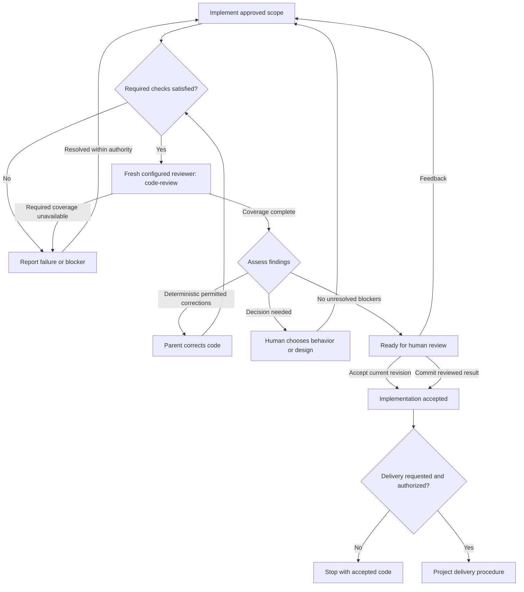

# Workflow

How the skills connect, from setup to delivery. The [README](README.md) gives the overview, the [catalog](docs/SKILLS.md) lists the skills, and each skill's `SKILL.md` holds its exact procedure.

## 1. Set up the project

`setup-workflow` reads the project, asks about the gaps, writes the rules and installs the chosen skills. You approve the rules and the installation separately. The rules cover where tasks and requirements live, what the agent may do, how to test and review, where a human checks the work and how to commit and deliver; the full list is in [SETUP.md](docs/SETUP.md#what-setup-asks-about).

The rules go to root `AGENTS.md`. Memory goes to `CONTEXT.md` and `LESSONS.md` in `.docs/`; the folder can change, the file names cannot. Setup keeps existing project rules instead of replacing them with a template.

A rerun shows the current settings and gaps, then asks what to change. Installing a skill does not enable its workflow and does not grant permission for its actions.

## 2. Understand and shape the task

The task starts as an idea, an incident, a change request or an approved spec. Use only the steps the uncertainty needs:

| Situation | Skill | Ready to implement when |
| --- | --- | --- |
| Unclear goal or missed constraints | `grilling`; `grill-with-docs` if domain terms also need work | Goal, limits and blocking questions are agreed |
| Unclear domain terms or important choices | `grill-with-docs` | Shared terms and accepted decisions, recorded where useful |
| Missing facts | Ordinary read-only exploration; `research` for a reusable report | Findings with sources and stated remaining doubts |
| Large, uncertain effort | `wayfinder`, with research or bounded experiments if needed | A route through decision tickets (not implementation tasks) |
| Module or interface design | Explore the existing code and trade-offs | A reasoned design direction, no automatic refactor |
| Incident or incoming task to evaluate | Follow the project procedure | Relevance, owner, related work and an allowed next step |
| Requirements to write or split | `to-spec`, then `to-tickets` if useful | Approved requirements and checkable slices with real dependencies |
| Ready requirements from an analyst | Read the source directly | Enough context and acceptance criteria to start |

Read-only sources such as Jira or Confluence are enough for analysis; the agent does not comment on them, change statuses or copy them into local specs. Documents go where the project keeps them. A task rarely needs an ADR, a spec, tickets and a glossary all at once.

**Exit:** the implementer knows what to build, the scope, the accepted constraints, the sources and how acceptance will be checked. Blocking decisions are resolved or explicitly left out of scope. Being ready does not mean permission to start.

### Session boundaries

Implementation can continue in the same thread; compaction or a new session is optional. In a new session, the agent reads `CONTEXT.md` and the task sources, then checks the current state of the code instead of trusting memory. The kit has no `handoff` skill.

## 3. Implement and verify

`implement` handles one agreed task, `implement-spec` a spec and its slices. Neither needs a new local spec or tracker. Both use `code-review` with its [shared implementation cycle](skills/code-review/references/implementation-cycle.md) and `human-text` for the final explanation.

Before editing, the agent settles repositories, worktrees, branches and file ownership, and records the task's base commit so a resumed task reviews the whole change. Delegation, parallel work and integration follow project rules; a separate worktree or integration branch is optional.

### Optional TDD

`tdd` runs only when you ask for it. The implementer launches a fresh test-author subagent and gives it the requirements, agreed interfaces and test rules, but not its own plan. The author owns the test files in the shared working copy.

Each cycle covers one behavior. The author writes one test and shows that it fails because the behavior is missing. The implementer writes just enough code to pass it, then refactors while the tests stay green. If the client cannot launch subagents, you choose: a separate session for the test author, or tests written by the implementer and reported as not independent.

A project may instead allow tests and code to be written in parallel: the tests stay independent, but the order is no longer test-first. In both modes, the accepted requirements settle a disagreement; the test is not weakened to pass.

Without TDD, the implementer still runs the project's required checks. Adding SQL does not by itself allow a database container: if the allowed test level cannot prove a required property, the agent reports the gap and asks.

### Review and acceptance

The [shared cycle](skills/code-review/references/implementation-cycle.md) holds the exact steps. In short:

1. After the checks pass, the agent launches a fresh reviewer subagent: the role and model from the project rules, or the client's general-purpose subagent. This is a step in the skill, not an installed hook. Without subagents, you run `code-review` in a separate session with the agent's brief, and that result counts. The agent's review of its own work never counts.
2. The reviewer gets the skill, the project rules and review skills, the task and acceptance criteria, the exact change (including uncommitted and untracked files) and the check results. It reports Standards and Spec findings and edits nothing. A review of an older revision does not count for a newer one.
3. The agent fixes a finding itself only when the project permits automatic fixes, the rule allows exactly one fix and the fix keeps behavior. A small diff or a low severity does not make a fix safe. Requirement, business, architecture and scope choices go to you.
4. After fixes, the checks run again and a fresh reviewer sees the whole updated change with earlier findings and your answers. A repeated finding or conflicting advice goes to you. After three review rounds the agent stops and asks how to proceed.
5. The agent explains what changed, how it works, which files to look at and what was verified. Then it lists the remaining findings and decisions, or says that none remain. Your feedback starts another round.

A missing required skill or source blocks the review. Incomplete required coverage blocks it even when the reviewer found nothing.

**Exit:** the current revision passed the required checks and review, no blockers remain, and you explicitly accept it. Asking to commit the reviewed result counts as acceptance; asking for a WIP commit does not. Stopping unfinished work is a stopped state, not completion.

`code-review` also works on its own, in any thread, without the implementation skills.

## 4. Deliver through the project procedure

Acceptance does not commit, push, open a PR/MR, close tasks or merge. Each of these needs its own permission. Commit rules come from setup; the kit has no commit skill. A project may allow intermediate commits or early draft PRs; that does not change what counts as acceptance.

Prepare or publish PRs/MRs through the project procedure and only within its permissions. Preparing text does not authorize Git writes or publication. Pending CI stays pending; an open PR does not mean merge, deploy or branch cleanup.

## 5. Learn and maintain

These skills run whenever useful: during a task, between tasks or after delivery.

- `retro` discusses what happened with you. Confirmed lessons go to `LESSONS.md`; a short summary and open questions go to `CONTEXT.md`. Mandatory rules and important decisions stay in their own documents; a lesson can link to them but not override them.
- `refactor-docs` improves existing documents without changing their meaning; it requires `human-text`.
- `cleanup` proposes which outdated artifacts to retire, with evidence, then makes only the approved changes in a recoverable way.
- `human-text` can guide all text for people when the project enables it in setup.
- `ask-workflow` answers workflow questions at any stage: it reads the rules and skills, recommends a route and stops.

## What is not verified

The skills describe expected agent behavior. A package that installs and appears in the client can still be ignored by the model. Before relying on a route, try it in your client and note what actually happened. The kit installs no scheduler, review hook, updater or permission system.
