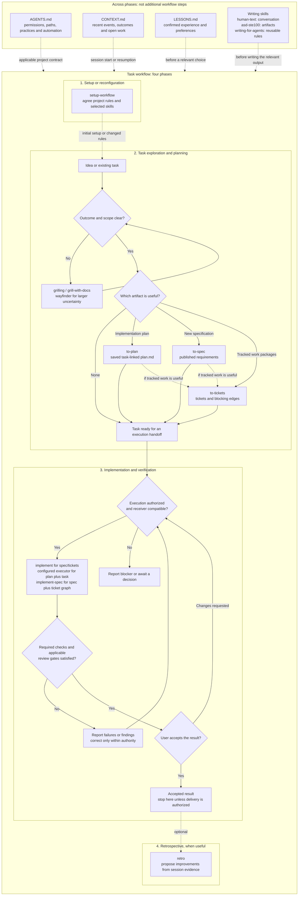

# Workflow and package composition

The repository combines Matt-derived skills, local setup and writing tools.
The [catalog](docs/SKILLS.md) describes invocation and prerequisites. The [source ledger](docs/UPSTREAM.md) records exact copies and minimal adaptations.

## Route map

The four phases organize the kit; they are not four mandatory invocations for every task.
Arrows show possible handoffs, not an automated pipeline. Check selected packages and project permissions before following a route.



Plan approval is not execution permission. Passing checks is not user acceptance or permission to publish.
An accepted result can stop without a push or PR. Delivery follows the project's separately authorized procedure.

## 1. Setup and reconfiguration

For a project spanning repositories, optionally invoke [`home-repo-init`](skills/home-repo-init/SKILL.md) before configuring its workflow.
It establishes home structure, repository navigation and approved shared materials. It is a manual setup-stage option, not a required phase.
Then invoke `setup-workflow` only if workflow procedures need configuration. Use `to-plan` separately for a task's implementation plan.
Home navigation preserves child rules and requires reading them before work.
Verify instruction pointers and skill access for child-start sessions and delegated workers; a sibling home is not automatically loaded.
See [home setup](docs/SETUP.md#optional-home-for-multiple-repositories) for scope, approval and access decisions.

`setup-workflow` reads existing rules and asks about unresolved decisions. It offers separate choices when the options are known and accepts project-specific procedures or source links.
It records mandatory restrictions and tool permissions, including for MCP integrations. It previews rule changes separately from installation.
Root `AGENTS.md` holds shared rules and sections for selected skills. User additions can name other skills, coding practices and examples.
The [reference structure](skills/setup-workflow/references/AGENTS.md) defines that organization and the automation settings. It grants no permissions.
Context and lessons share the selected directory, default `.docs/`.

The project can assign conversation to `human-text`, artifact prose to `asd-ste100`, and reusable rules to `writing-for-agents`.
The [writing contract](skills/setup-workflow/references/writing.md) defines optional integration and loading triggers.
Neither installing a package nor saving desired configuration grants operational permission.

## 2. Task exploration and planning

Start from the actual task, not from a required chain of documents.

- Use [`grilling`](skills/grilling/SKILL.md) to clarify an idea or challenge a decision. Use [`grill-with-docs`](skills/grill-with-docs/SKILL.md) when the discussion also develops domain records; it calls `domain-modeling`.
- Use [`wayfinder`](skills/wayfinder/SKILL.md) for a large effort with unresolved decisions. Its research, prototype and discussion tickets find answers, not implementation assignments.
- Use [`research`](skills/research/SKILL.md) for a primary-source investigation and [`prototype`](skills/prototype/SKILL.md) for a concrete design experiment when those are needed.
- Use [`to-spec`](skills/to-spec/SKILL.md) to synthesize agreed requirements when a new specification is useful. Preserve an existing analyst-owned requirement source instead of rewriting it.
- Use [`to-tickets`](skills/to-tickets/SKILL.md) when work needs separately tracked assignments and blocking edges. It can take a plan, specification or discussion.

### Optional implementation planning

Use [`to-plan`](skills/to-plan/SKILL.md) when a task is already understood but needs a concrete implementation handoff.
It saves one Markdown plan with the task's other artifacts, using project paths and permissions.
A specification and tracker tickets are optional inputs, not prerequisites.
The plan records the approach, work packages, dependencies and checks. Multi-service work has sections by service and executor responsibility, one shared contract definition and an integration check.
Parallel work also identifies disjoint file ownership and how each executor can read the common plan.
Planning stops at the saved artifact and does not start implementation agents. Approved diagram-only delegation is the optional exception described below.

Setup agrees a receiving executor and records how it reads the approved plan and source task in project instructions.
Setup does not modify the bundled prompts. `implement-spec` still requires its specification and ticket graph.
`to-tickets` can decompose a plan when separately tracked work is useful; it is not required for plan-based execution.

### Optional design diagrams

[`excalidraw-diagram`](skills/excalidraw-diagram/SKILL.md) is bundled support, not another phase or a prerequisite for planning.
Offer it only when a diagram would clarify a design question. Selecting or installing the package does not authorize generation.
After user consent, delegate drawing to a separate subagent through the project's selected tool, including Orca when configured.
An explicit diagram request counts as consent. If the user declines, continue without dispatch or diagram writes.
If the skill, worker capability, source assets or render permission is unavailable, report the diagram blocker and continue the textual work.
Do not generate the diagram in the coordinator's context as a fallback.

Pass a narrow brief with facts and decision status, source pointers, the question and audience, permitted output paths and libraries.
Only the drawing worker loads generation instructions and library JSON. It returns file paths, visual-check results and caveats, not raw JSON or a transcript.
Save editable `.excalidraw` source and a PNG preview beside the relevant task, ADR, specification or plan, under configured paths.
Link these supporting artifacts from the authoritative text. Diagrams do not replace ADR decisions, contracts or runnable prototypes.
Consent to draw is not acceptance of a design, approval of a plan or permission to implement.
Use the [package procedure](skills/excalidraw-diagram/SKILL.md) and [generated project rules](skills/setup-workflow/references/AGENTS.md) for the full contract.

## 3. Implementation and verification

Choose the receiver by its actual input contract:

- [`implement`](skills/implement/SKILL.md) handles a task described by a specification or tickets. By default, it calls TDD where possible, runs checks and reviews the task's changes before an authorized commit.
- A project-configured executor can consume an approved plan plus its source task. Pass shared contracts and the assigned work package to each delegated worker. Use Orca when the user's or project's rules select it.
- [`implement-spec`](skills/implement-spec/SKILL.md) coordinates a specification and ticket graph through integration branches, per-ticket workers and worktrees. It is not a plan-only executor.

There is no `implement-plan` skill in this kit. For a plan-only route, use the executor agreed during setup or give a compatible agent an explicit execution request.
Inspect original branch, tracker, commit and publication actions before starting; the route must fit project permissions.

[`tdd`](skills/tdd/SKILL.md) is a red–green cycle, not a separate bulk test-writing phase.
Project settings select automatic or manual TDD and review, their execution location and review followup.
Manual means a separate user invocation, not an automatic launch by implementation.
Manual review is a completion gate only when project rules require it; otherwise the user decides whether to request it.

By default, `implement` passes the task's file paths and review base to the bundled [`code-review`](skills/code-review/SKILL.md) before committing.
Both reviewers use the same pinned Git tree. It captures the latest intended changes in staged, unstaged and nonignored untracked files without including unrelated work.
The bundled skill also supports explicit committed branch, PR and commit reviews. `implement-spec` reviews its integration branch after merging the tickets.
Project settings take precedence. Require a custom reviewer only if the bundled procedure cannot cover the chosen policy or approved scope. Report any remaining [coverage gap](skills/setup-workflow/references/AGENTS.md#review-coverage).
Report-only review returns findings for a decision. Fix-and-rereview permits corrections only within the agreed scope and cycle limit.
Failed required checks, inaccessible mandatory sources and unresolved required review findings do not count as success.
The user accepts the work. Review grants no permission to commit, push, open a PR/MR, merge or deploy.

## 4. Retrospective and maintenance

Use [`retro`](skills/retro/SKILL.md) when session evidence suggests improvements to the agent environment.
Its proposals do not become approved rules automatically. Record accepted outcomes in their authoritative destination under the project's memory rules.
[`refactor-docs`](skills/refactor-docs/SKILL.md) improves existing prose without changing its meaning.
[`cleanup`](skills/cleanup/SKILL.md) reviews stale artifacts and applies only approved, recoverable changes.
These maintenance skills can run between tasks; none is a mandatory end-of-task stage.

## Shared context and writing

The graph's shared block applies across the selected phases. It is not a fifth phase.

- **Root `AGENTS.md`:** owns project procedures, permissions, artifact paths, practices and automation settings. Read the relevant rules before acting.
- **`CONTEXT.md`:** recovers recent work at session start or resumption. Update it at the agreed checkpoints; verify recorded task/code state against current sources.
- **`LESSONS.md`:** informs relevant choices with confirmed experience and preferences. It does not override requirements or mandatory rules.
- **`human-text`:** governs conversation when selected, loaded before the first reply of a session.
- **`asd-ste100`:** governs artifact prose when selected, including plan/spec/ticket drafts and memory updates.
- **`writing-for-agents`:** governs reusable rules when selected, including skills and `AGENTS.md`. Choose the writing route by section purpose in mixed documents.

Memory lives in the selected shared directory, default `.docs/`. Task artifacts stay in their configured task locations, not in project memory.
For example, `plan.md` records an implementation approach; `CONTEXT.md` can link to it and record the handoff rather than copy its contents.
Delegated workers need applicable rules, relevant context and readable artifact pointers; access in the coordinator's worktree does not prove access elsewhere.
See [memory ownership and triggers](skills/setup-workflow/references/project-artifacts.md) and [writing activation](skills/setup-workflow/references/writing.md).

## Worked examples

The commands below are separate user actions, not one script to run blindly.
Slash notation is used for readability; Codex uses `$skill-name`.
Use the examples only with installed packages and authorized sources and actions.

### A ready task from Jira needs a plan

1. Read the task and the applicable project rules. Keep Jira as the requirements source.
2. Ask for a saved implementation plan:

   ```text
   /to-plan Plan APP-123 from its Jira requirements. Save it with this task's artifacts. Do not implement it.
   ```

3. Review the saved plan and resolve blocking decisions.
4. Give the selected executor an explicit request:

   ```text
   Execute the approved plan at <plan-path> and read its source task. Follow project TDD, review and delivery rules.
   ```

No `to-spec` or `to-tickets` call is needed. If no compatible plan receiver is configured, agree one before execution.

### An idea needs requirements and tracked work

1. Use `/grilling` or `/grill-with-docs` to settle the outcome and boundaries. Use `/wayfinder` if the unresolved decisions need a larger map.
2. Use `/to-spec` only if a new specification is needed.
3. Use `/to-tickets` when implementation work should be tracked separately; review its breakdown and blocking edges before publication.
4. Invoke `/implement-spec` with both the specification and ticket graph after checking its operations and permissions.
5. Complete the configured checks and review, then inspect the result as the user.

### One change spans several services

1. Ask `/to-plan` for one shared plan with service/repository responsibilities and shared contracts.
2. Review API or event contracts, dependency order, file ownership and the cross-service check.
3. Authorize the chosen coordinator to assign the plan's work packages through Orca where configured. A work package is not automatically a tracker ticket.
4. Each worker reads its assignment, relevant shared contracts and project rules. The coordinator integrates results and checks the complete interaction.
5. Inspect the integrated result. Run `/retro` only when useful, and save approved outcomes under the project's memory rules.

## Project settings and defaults

Twelve skills read project instructions before starting: `code-review`, `implement`, `implement-spec`, `research`, `retro`, `tdd`, `to-spec`, `to-tickets`, `wayfinder`, `domain-modeling`, `prototype` and `codebase-design`.
Specified sources, paths and workflow settings apply. Unspecified settings use the bundled defaults.
The [source ledger](docs/UPSTREAM.md) records the local adaptations to M1, including the review changes to `code-review` and `implement`. `grill-with-docs` and `writing-for-agents` remain exact copies.
The kit includes all fixed helper dependencies; check [the required client installations](skills/setup-workflow/references/catalog.md#dependencies).

- `grilling` remains our adapted interview and can run without setup.
- `grill-with-docs` delegates to other skills rather than containing our previous interview procedure.
- `wayfinder` calls `grilling`, `domain-modeling`, `research` and `prototype` on their original branches.
- `tdd` consults `codebase-design` when the interface or test seam is in question.
- `to-spec` and `to-tickets` use project artifact settings where specified, with upstream formats and publication defaults elsewhere.
- `implement` and `implement-spec` use the agreed TDD and review settings. Their default review checkpoints differ: before commit for `implement`, after ticket merges for `implement-spec`.
- `retro` proposes environment improvements. Recording approved outcomes in project memory needs an explicit project rule.


## Project compatibility

Setup reads the selected skills before promising a configured route.
For TDD and review, setup asks separately about automatic or manual launch and execution location, in that order for each activity.
It also agrees the applicable implementation routes and reporting versus authorized fixes with another review.
Test practices and review sources come from the project. The user accepts the work; acceptance is not a flag.
Setup [matches review coverage to each implementation checkpoint](skills/setup-workflow/references/AGENTS.md#review-coverage). It checks whether the selected procedure covers the approved scope at that point.

Setup does not rewrite installed packages. An unavailable helper or conflicting mandatory step must be reported.
Settings are prompt instructions, not an execution engine. Delegated workers need the applicable rules and readable source pointers.

## Verification limits

Byte equality establishes that the packages match the pinned source.
Installation and metadata checks establish packaging and discovery, not model adherence or runtime readiness.
Missing prerequisites and unexercised client capabilities remain explicit.
The repository installs no scheduler, update service or permission mechanism.

