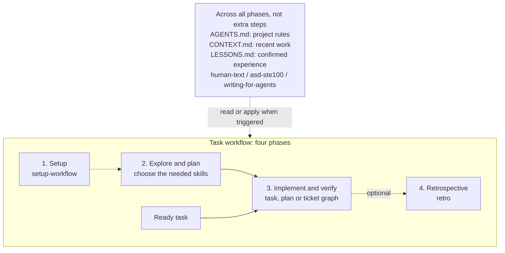

# agent-workflow

Workflow skills for coding agents, based on [Matt Pocock's skills](https://github.com/mattpocock/skills), with project setup and writing tools.
Packages keep upstream behavior except for [documented adaptations](docs/UPSTREAM.md). The kit includes their fixed skill dependencies.
Project instructions define paths, practices and automation; these prompts do not enforce permissions.

## How it works



Setup runs initially or when project rules change. A ready task can skip exploration and planning; retrospective is optional.
Project rules select automatic or manual TDD/review and permitted actions. The user accepts the result.
See [FLOW.md](FLOW.md#route-map) for skill choices, handoffs and worked examples. Revisit earlier decisions when new evidence changes the approach.

## Install

You need Node.js 22.20+ and a local copy of this repository. Install selected skills independently:

```bash
npx skills@1.9.0 add ~/projects/agent-workflow --skill human-text --agent codex
npx skills@1.9.0 add ~/projects/agent-workflow --skill asd-ste100 --agent codex
```

Replace `--skill` with any name in the [catalog](docs/SKILLS.md). Check its required helpers before use.
Use `--agent claude-code` for Claude Code. Add `--global` only for an intended user-wide installation.

For work across several repositories, optionally run [`home-repo-init`](skills/home-repo-init/SKILL.md) to agree a home for navigation and shared materials. It preserves child code and rules, previews changes, and waits for approval. Then use `setup-workflow` if that home needs workflow procedures. Use `to-plan` for individual task plans.

For project configuration, install and run `/setup-workflow` (`$setup-workflow` in Codex). It:

1. Reads existing instructions, documentation, scripts and CI.
2. Discusses test practices, automation, permissions, artifact locations and additional guidance.
3. Shows the draft rules and, separately, the list of skills to install.
4. After approval, writes the project rules and installs only the approved packages.

The result:

```text
AGENTS.md          project rules for the agent
.docs/CONTEXT.md   recent work and open questions
.docs/LESSONS.md   confirmed lessons
```

You can change the `.docs/` directory; the file names stay fixed. Existing systems such as Jira or Confluence remain authoritative.
Rerun setup to change selected settings and preserve the rest.
Setup records skill-specific rules and writing triggers in `AGENTS.md`; it does not rewrite installed skills.

Keep bundled licenses. For kit packages without one, include the applicable [third-party notice](THIRD_PARTY_NOTICES.md#distribution) with installation or export.
See [SETUP.md](docs/SETUP.md) for client configuration and installation scope.

## Which skill to use

The [catalog](docs/SKILLS.md) lists skills, outputs and prerequisites. For a recommendation, install and invoke `ask-workflow`:

```text
/ask-workflow I have an approved task from Jira. What should I use next?
```

It recommends a skill and stops; it does not start the work.

For a clear task that needs a saved implementation plan, use [`to-plan`](skills/to-plan/SKILL.md).
It saves the plan with the task's artifacts. Specifications and tickets are optional; execution is a separate handoff to the project-selected agent.

### Optional design diagrams

The bundled [`excalidraw-diagram`](skills/excalidraw-diagram/SKILL.md) can illustrate a design question. It is not a required phase.
When a diagram would help, the agent offers it. Package selection is not consent to generate one.
After your approval, a separate drawing subagent receives a narrow brief. An explicit diagram request already supplies consent.
If you decline, discussion continues without drawing. Missing capabilities or permissions block only the diagram branch; the coordinator does not draw instead.

The worker saves editable `.excalidraw` source and a PNG preview beside the task, ADR, specification or plan, under configured paths.
Decisions and contracts remain in their authoritative text. A diagram does not replace a runnable prototype.
See the [package](skills/excalidraw-diagram/SKILL.md) for generation and renderer requirements, and [setup rules](skills/setup-workflow/references/AGENTS.md) for project integration.
Four libraries are bundled: `post-it`, `drwnio`, `system-design` and `software-architecture`.
The [library guide](skills/excalidraw-diagram/references/libraries.md) records their sources and usage. [Excalidraw Libraries](https://libraries.excalidraw.com/) provides other downloadable `.excalidrawlib` collections.

## Additional tools

These optional tools are separate from the bundled workflow. Setup does not install or activate them automatically.
Choose the client and installation scope explicitly. Follow each external package's setup and permission requirements.

### Agent workspace

| Tool | Use it for | Install |
| --- | --- | --- |
| [Orca](https://orca.dev/) ([source](https://github.com/stablyai/orca)) | Run coding agents in separate worktrees, with chat, terminals, diffs and a browser | [Download Orca](https://orca.dev/download) |
| [Excalidraw for Orca](https://orca.dev/plugins/stablyai/orca-plugins/orca-excalidraw) | Draw and edit `.excalidraw`, `.excalidraw.svg` and `.excalidraw.png` files in the editor | Orca **Settings → Plugins → Excalidraw → Install** |

The bundled diagram skill creates files; the Orca plugin lets you edit them. Neither requires the other.

### Web & UI

| Tool or skill | Use it for | Install |
| --- | --- | --- |
| [Modern Web Guidance](https://github.com/GoogleChrome/modern-web-guidance) | Modern CSS, browser APIs, accessibility and web performance guidance | `npx modern-web-guidance@latest install` |
| [learn-taste by Emil Kowalski](https://github.com/emilkowalski/skills/blob/main/skills/learn-taste/SKILL.md) | Turn recurring UI corrections into design rules with their reasons | `npx skills@latest add emilkowalski/skills --skill learn-taste` |

At the end of a design session, for example in Claude Code:

```text
/learn-taste Also review my last three sessions. I keep correcting the same UI mistakes.
```

Earlier sessions require readable transcripts. The skill proposes changes to `DESIGN.md`, project skills or checks, then waits for approval before writing.

### Tooling

| Tool | Use it for | Install |
| --- | --- | --- |
| [agent-desktop](https://github.com/vercel-labs/agent-desktop) | Operate native desktop apps through OS accessibility APIs | `npm install -g agent-desktop` |
| [agent-browser by Vercel Labs](https://github.com/vercel-labs/agent-browser) | Drive a browser from the CLI for UI checks and interactive pages | `npm install -g agent-browser`, then `agent-browser install` |

These commands install the CLIs globally. Installation does not authorize desktop or authenticated website actions.

### Research & documentation

`research` is already bundled for Wayfinder. The upstream command below is for standalone use; avoid duplicate copies in one client.

| Skill | Use it for | Install |
| --- | --- | --- |
| [research by Matt Pocock](https://github.com/mattpocock/skills/blob/main/skills/engineering/research/SKILL.md) | Delegate a primary-source investigation and produce a cited Markdown report | `npx skills@latest add mattpocock/skills --skill research` |
| [find-docs by Context7](https://github.com/upstash/context7/blob/master/skills/find-docs/SKILL.md) | Fetch current library and API documentation through the Context7 CLI, without an MCP server | `npx skills@latest add upstash/context7 --skill find-docs` |

`research` needs background-agent support and permission to write its report. `find-docs` uses `npx ctx7@latest` for documentation queries.
Context7 also provides a separate [CLI/MCP setup guide](https://github.com/upstash/context7/blob/master/docs/clients/cli.mdx).

## Documentation

| Read | For |
| --- | --- |
| [Workflow](FLOW.md) | How the steps connect: planning, tests, review, acceptance, delivery |
| [Skill catalog](docs/SKILLS.md) | Every skill, its result, how it is invoked and what it depends on |
| [Installation and setup](docs/SETUP.md) | Install scope, what setup asks, the files it creates, troubleshooting |
| [Maintaining the kit](docs/MAINTENANCE.md) | Changing skills and checking the change |
| [Upstream sources](docs/UPSTREAM.md) | Original skills, pinned revisions and what was changed locally |
| [Repository instructions](AGENTS.md) | Rules for agents that maintain this repository |

## Status and license

Package metadata and discovery were checked in isolated test projects. A full setup-to-PR run has not been tested.
Client behavior can differ. The kit installs no hooks, background updates or services.

Original contributions are [MIT-licensed](LICENSE). Third-party material retains its [notices and rights](THIRD_PARTY_NOTICES.md), including the Excalidraw package's unresolved redistribution permission. Read [UPSTREAM.md](docs/UPSTREAM.md) before redistributing or updating imported material.
