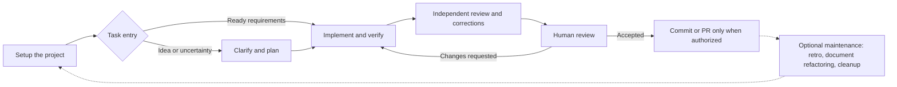

# agent-workflow

Skills for coding agents (Claude Code, Codex, OMP) that follow your project's rules. You run setup once: the agent learns where tasks come from, how to test, who reviews and what it may do without asking. After that you call only the skills a task needs.

The kit adapts skills from [Matt Pocock](https://github.com/mattpocock/skills) and [Kirill Sachkov](https://github.com/KirillSachkov/agent-kit). The skills are prompts: they tell the agent what to do, but they do not enforce permissions or run on their own.

## How it works



A typical task:

1. You run `/setup-agents-workflow` once per project. The agent reads the repository, asks about the gaps and writes the rules to `AGENTS.md`.
2. If the task is unclear, you discuss it first: `/grilling` asks questions until the goal and limits are agreed, `/to-spec` turns the discussion into requirements. Ready requirements, for example from Jira, skip this step.
3. You run `/implement` with the task. The agent writes the code and runs the project checks. If you ask for TDD, a separate subagent writes the tests first.
4. A fresh reviewer subagent checks the change. The agent fixes clear-cut findings itself and brings decisions to you. After three review rounds it stops and asks you how to proceed.
5. The agent explains what changed, how it works and which files to look at. You accept the result or give feedback, which starts another round.
6. The agent commits only on your request or under project rules. `/pr` prepares or opens a pull request when you ask.

If your client cannot launch subagents, you run `/code-review` in a separate session with the brief the agent prepares. In Codex, skills start with `$` instead of `/`.

## Install

You need Node.js 22.20+ and a local copy of this repository. From the project you want to configure, run:

```bash
npx skills@1.9.0 add ~/projects/agent-workflow --skill setup-agents-workflow --skill writing-for-agents
```

The installer asks which client to use; `--agent claude-code` or `--agent codex` skips the question. Add `--global` to install for all your projects. The public repository `FOZERY/agent-workflow` had no published skills on 2026-11-16, so install from a local copy.

Then run `/setup-agents-workflow`. The agent:

1. Reads existing instructions, documentation, scripts and CI.
2. Asks about what it could not find: tests, reviewer model, permissions, where tasks and documents live.
3. Shows the draft rules and, separately, the list of skills to install.
4. After your approval, writes the rules and installs the chosen skills with their dependencies.

The result:

```text
AGENTS.md          project rules for the agent
.docs/CONTEXT.md   recent work and open questions
.docs/LESSONS.md   confirmed lessons
```

You can choose another folder instead of `.docs/`; the file names stay fixed. Jira, Confluence and other existing sources stay the source of truth. Run setup again to see the current settings and change some of them; the rest stays as it was.

The installer copies skill folders without the root license files. Keep `LICENSE` and `THIRD_PARTY_NOTICES.md` next to installed copies ([details](THIRD_PARTY_NOTICES.md#distribution)). Scope choice, OMP and troubleshooting are in [SETUP.md](docs/SETUP.md).

## Which skill to use

[The skill catalog](docs/SKILLS.md) lists every skill and what it produces. If you are unsure, install `ask-workflow` and ask it:

```text
/ask-workflow I have an approved task from Jira. What should I use next?
```

It recommends a skill and stops; it does not start the work.

## Documentation

| Read | For |
| --- | --- |
| [Workflow](FLOW.md) | How the steps connect: planning, tests, review, acceptance, delivery |
| [Skill catalog](docs/SKILLS.md) | Every skill, its result, how it is invoked and what it depends on |
| [Installation and setup](docs/SETUP.md) | Install scope, what setup asks, the files it creates, troubleshooting |
| [Maintaining the kit](docs/MAINTENANCE.md) | Changing skills and checking the change |
| [Upstream sources](docs/UPSTREAM.md) | Original skills, pinned revisions and what was changed locally |
| [Repository instructions](AGENTS.md) | Rules for agents that maintain this repository |

## Status and license

Package metadata and discovery were checked in isolated test projects. A full run from setup to PR has not been tested, and clients may behave differently. The repository installs no hooks, background updates or services.

Original contributions are [MIT-licensed](LICENSE). Third-party material keeps its [copyright notices and MIT terms](THIRD_PARTY_NOTICES.md), including HumanLayer material in the optional PR body format. Read [UPSTREAM.md](docs/UPSTREAM.md) before redistributing or updating the adapted skills.
