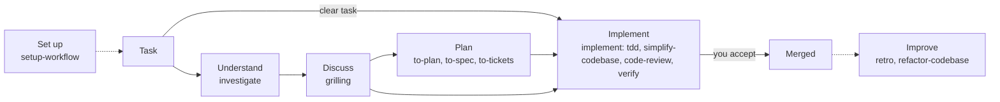

# agent-workflow

[Русская версия](docs/README.ru.md)

A workflow for coding agents, built from small skills. Each skill does one step: study a task, discuss it, plan it, implement it, review it, learn from it. Your project's rules sit on top of the steps: `setup-workflow` writes them into the project's `AGENTS.md`, and every skill reads them there.

The kit adapts [Matt Pocock's skills](https://github.com/mattpocock/skills) and skills from [pstack](https://github.com/cursor/plugins/tree/main/harness/pstack) by Lauren Tan, and adds its own skills, such as `to-plan`, `verify` and `writing-technical`. It runs no automatic pipeline. You choose the steps, and the project's permissions decide what the agent may do alone.

## Install

Use Node.js 22.20 or later. In your project directory, install `setup-workflow` from GitHub:

```bash
npx skills@latest add FOZERY/agent-workflow --skill setup-workflow --agent claude-code
```

For Codex, use `--agent codex`. Add `--global` for a user-wide install. To install another skill, replace `setup-workflow` with its name. For other clients and scopes, see [skill deployment](skills/setup-workflow/references/skills.md).

## Get started

1. Run `/setup-workflow` (`$setup-workflow` in Codex). It asks about your rules, checks, permissions, fact sources and agents, offers the skills, and writes `AGENTS.md`.
2. Give the agent a task. For a new task that you do not know well, start with `/investigate`. For a clear task, ask the agent to implement it: `implement` starts on its own.

Not sure which skill fits? Run `/ask-workflow` with your question. It recommends a skill and starts nothing.

## The workflow



Every step is optional. A small, clear task goes straight to `implement`.

The [skill guide](docs/GUIDE.md) describes each skill with an example prompt. The [workflow routes](docs/FLOW.md) show which step to take for the task that you have.

## Skills by step

"Human" means that the skill runs only when a person types it. "Agent" means that the agent can also start it when the task fits.

| Step | Skill | Starts | What it does |
| --- | --- | --- | --- |
| Set up | [`setup-workflow`](skills/setup-workflow/SKILL.md) | Human | Agrees the project rules, checks, permissions and agents, and writes `AGENTS.md` |
| | [`setup-home-repo`](skills/setup-home-repo/SKILL.md) | Human | Makes one home for several repositories without moving their code |
| | [`ask-workflow`](skills/ask-workflow/SKILL.md) | Human | Recommends the next skill for your situation |
| Understand | [`investigate`](skills/investigate/SKILL.md) | Human | Studies a task's history and code, saves a facts file and explains the task in plain words |
| | [`recall`](skills/recall/SKILL.md) | Human | Rebuilds where your recent work on a topic stands and what to do next |
| | [`research`](skills/research/SKILL.md) | Agent | Answers a question from primary sources in a cited report |
| Discuss | [`grilling`](skills/grilling/SKILL.md) | Agent | Asks questions until the open decisions of an idea are settled |
| | [`grill-with-docs`](skills/grill-with-docs/SKILL.md) | Human | The same, and records terms and decisions as it goes |
| | [`domain-modeling`](skills/domain-modeling/SKILL.md) | Agent | Keeps the glossary and ADRs |
| | [`prototype`](skills/prototype/SKILL.md) | Agent | Builds throwaway code to answer a design question |
| Plan | [`to-plan`](skills/to-plan/SKILL.md) | Human | Saves an implementation plan for a task |
| | [`to-spec`](skills/to-spec/SKILL.md) | Human | Turns the discussion into a spec in the tracker |
| | [`to-tickets`](skills/to-tickets/SKILL.md) | Human | Splits work into tickets with dependencies |
| | [`wayfinder`](skills/wayfinder/SKILL.md) | Human | Maps a large, unclear effort as decision tickets |
| Implement | [`implement`](skills/implement/SKILL.md) | Agent | Orchestrates a task: writes small changes, gives larger ones to workers, checks the result |
| | [`tdd`](skills/tdd/SKILL.md) | Agent | Writes integration and module tests that prove real behavior, test first |
| | [`simplify-codebase`](skills/simplify-codebase/SKILL.md) | Agent | Finds what to simplify in changed code |
| | [`verify`](skills/verify/SKILL.md) | Agent | Checks that a change works in the running product, the way the project agreed |
| | [`code-review`](skills/code-review/SKILL.md) | Agent | Reviews a diff against the project standards and the task |
| Improve | [`retro`](skills/retro/SKILL.md) | Human | Turns mistakes from recent sessions into skills and rules |
| | [`refactor-codebase`](skills/refactor-codebase/SKILL.md) | Human | Finds structural problems after a stage of work and rewrites one |
| | [`refactor-docs`](skills/refactor-docs/SKILL.md) | Human | Rewrites documents for clarity without changing what they say |
| | [`cleanup-artifacts`](skills/cleanup-artifacts/SKILL.md) | Human | Reviews stale notes and plans and removes the approved ones recoverably |
| Write | [`writing-for-people`](skills/writing-for-people/SKILL.md) | Agent | Clear replies and explanations for people |
| | [`writing-technical`](skills/writing-technical/SKILL.md) | Agent | Clear technical documents in controlled English |
| | [`writing-for-agents`](skills/writing-for-agents/SKILL.md) | Agent | Skills and `AGENTS.md` that agents follow the same way every time |
| | [`rephrase`](skills/rephrase/SKILL.md) | Human | Restates the last reply in plain words |

## External tools

These tools are not part of the kit. Setup recommends the UI check tools when you select `verify` for a project with a UI, and installs nothing without your approval.

- **UI checks for `verify`:** [agent-browser](https://github.com/vercel-labs/agent-browser) lets the agent open, click through and screenshot web pages. [agent-desktop](https://github.com/vercel-labs/agent-desktop) does the same for native apps.
- **Agent workspace:** [Orca](https://orca.dev/) for worktrees and agent sessions. Its [Excalidraw plugin](https://orca.dev/plugins/stablyai/orca-plugins/orca-excalidraw) draws and edits diagrams.
- **Diagrams in the terminal:** the [termaid plugin for Claude Code](https://termaid.com/claude-code.html) draws the Mermaid diagrams of a reply in the terminal while it streams. Install the `termaid` command with `brew install termaid`, then run `/plugin install termaid --marketplace fasouto/termaid`.
- **UI work:** [Modern Web Guidance](https://github.com/GoogleChrome/modern-web-guidance) for browser APIs, CSS, accessibility and performance. [learn-taste](https://github.com/emilkowalski/skills/blob/main/skills/learn-taste/SKILL.md) turns repeated design feedback into proposed project rules.
- **Library docs:** [find-docs](https://github.com/upstash/context7/blob/master/skills/find-docs/SKILL.md) for current API references through the Context7 CLI.

## Status and license

The skills were checked in isolated projects and in daily use. A full run from setup to a merged PR has not been tested end to end. To check the links and the contracts between the skills, run `python3 scripts/check.py`. CI runs it on every push.

Original contributions are [MIT-licensed](LICENSE). Third-party material keeps its [notices and rights](THIRD_PARTY_NOTICES.md). Keep the applicable [notices](THIRD_PARTY_NOTICES.md#distribution) with installed or exported skills.
