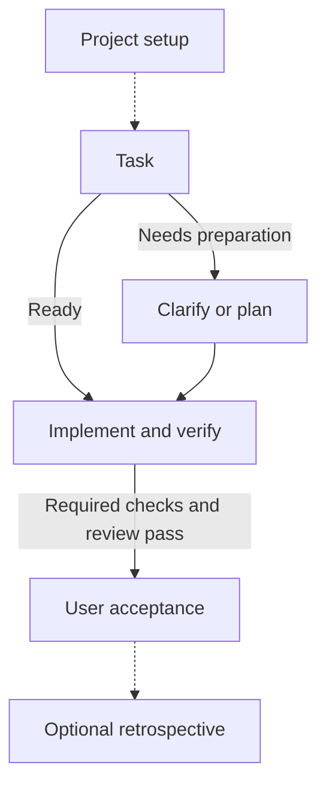

# agent-workflow

[Русская версия](docs/README.ru.md)

Build a project harness for your coding agent: instructions, skills, and tools that fit the way you work.
A skill is a reusable prompt for a specific job, such as planning a change or reviewing a diff.

The kit combines [Matt Pocock's skills](https://github.com/mattpocock/skills) with local setup, planning, and writing skills.
A task can start as an idea, a ready ticket, or a spec with dependent work.
Separate skills let you take only the steps you need, with your own requirements, checks, and tools.
The kit does not run an automated pipeline or enforce permissions.

## Core skills

| Skill | Use it when |
| --- | --- |
| [`setup-workflow`](skills/setup-workflow/SKILL.md) | You want to agree on project rules, checks, permissions, and which skills to install. |
| [`grilling`](skills/grilling/SKILL.md) | You need to find risks and unresolved decisions in an idea or plan. |
| [`wayfinder`](skills/wayfinder/SKILL.md) | A large effort has open questions that need separate decision tickets. |
| [`to-plan`](skills/to-plan/SKILL.md) | A clear task needs a saved implementation plan, without a new spec or tickets. |
| [`to-spec`](skills/to-spec/SKILL.md) | You need to turn agreed requirements into a new specification. |
| [`to-tickets`](skills/to-tickets/SKILL.md) | Work needs separately tracked tickets with explicit dependencies. |
| [`implement`](skills/implement/SKILL.md) | The current session should implement and verify one agreed task. |
| [`implement-with-swarm`](skills/implement-with-swarm/SKILL.md) | The main session should act as architect and coordinate workers on a large task. |
| [`tdd`](skills/tdd/SKILL.md) | You want to write a failing test, then make the smallest change that passes it, or audit existing tests. |
| [`code-review`](skills/code-review/SKILL.md) | You want to check a diff against project standards and task requirements. |
| [`simplify`](skills/simplify/SKILL.md) | You want changed code made simpler and clearer, and needless guards, fallbacks and abstractions removed. |

## Workflow

1. **Set up the project.** Run `setup-workflow` for initial setup or when rules change. Approve changes to `AGENTS.md` and skill installation separately.
2. **Prepare the task if needed.** Clarify open decisions or make a plan. If the task is ready, skip this step.
3. **Implement and verify.** Authorize an executor that accepts your task inputs. Get the results of project checks and any required review before accepting the work.
4. **Improve the harness if useful.** Run `retro` when a session exposes a problem worth fixing in the agent's setup.



Use the [workflow guide](docs/FLOW.md#route-map) to choose a route and hand the task to an executor.

## Additional skills

| Skill | Use it when |
| --- | --- |
| [`ask-workflow`](skills/ask-workflow/SKILL.md) | You want a recommendation for the next step without starting work. |
| [`home-repo-init`](skills/home-repo-init/SKILL.md) | Several repositories need a shared starting point without moving their code or rules. |
| [`grill-with-docs`](skills/grill-with-docs/SKILL.md) | A design discussion should also update the glossary or record a decision. |
| [`domain-modeling`](skills/domain-modeling/SKILL.md) | You need to agree domain terms or record an architectural decision. |
| [`research`](skills/research/SKILL.md) | A question needs a cited report based on primary sources. |
| [`prototype`](skills/prototype/SKILL.md) | You need a throwaway experiment to choose a UI or test a state model. |
| [`codebase-design`](skills/codebase-design/SKILL.md) | You need to design a module interface or make it easier to test. |
| [`excalidraw-diagram`](skills/excalidraw-diagram/SKILL.md) | A visual would clarify a design. After you consent, a separate worker creates an editable diagram and a PNG preview. |
| [`retro`](skills/retro/SKILL.md) | You want the agent to propose improvements based on what happened in a session. |
| [`refactor-docs`](skills/refactor-docs/SKILL.md) | Existing docs need clearer wording or structure without a change in meaning. |
| [`cleanup`](skills/cleanup/SKILL.md) | You want to review stale artifacts and approve which ones to remove recoverably. |
| [`human-text`](skills/human-text/SKILL.md) | You want clear replies and explanations for people. |
| [`asd-ste100`](skills/asd-ste100/SKILL.md) | You are writing technical docs, specs, tickets, or project memory. |
| [`writing-for-agents`](skills/writing-for-agents/SKILL.md) | You are writing reusable instructions such as a skill or `AGENTS.md`. |

### External tools

Setup does not install or activate these tools automatically.

- **Agent workspace:** [Orca](https://orca.dev/) for separate worktrees and agent sessions. Its [Excalidraw plugin](https://orca.dev/plugins/stablyai/orca-plugins/orca-excalidraw) edits diagrams without the diagram skill.
- **UI work:** [Modern Web Guidance](https://github.com/GoogleChrome/modern-web-guidance) for browser API, CSS, accessibility, and performance guidance. [learn-taste](https://github.com/emilkowalski/skills/blob/main/skills/learn-taste/SKILL.md) turns repeated design feedback into proposed project rules.
- **UI checks:** [agent-browser](https://github.com/vercel-labs/agent-browser) for interactive web pages. [agent-desktop](https://github.com/vercel-labs/agent-desktop) for native apps.
- **Library docs:** [find-docs](https://github.com/upstash/context7/blob/master/skills/find-docs/SKILL.md) for current API references through the Context7 CLI.

## Install

With Node.js 22.20+ and a local checkout of this kit, run this from your project:

```bash
npx skills@1.9.0 add ~/projects/agent-workflow --skill setup-workflow --agent codex
```

In Codex, run `$setup-workflow`. For Claude Code, install with `--agent claude-code`, then run `/setup-workflow`.
To install a different skill, replace `setup-workflow` in the install command with its name.
Setup writes `AGENTS.md` by the rules of `asd-ste100` and `writing-for-agents`. If they are missing, setup offers to install them.
Add `--global` only for a user-wide install.

For other clients or installation scopes, see [skill deployment](skills/setup-workflow/references/skills.md).

For an example of user-wide defaults, see the [global AGENTS.md reference](agents-files/AGENTS.reference.md). It is a snapshot, not a project instruction.

## Status and license

Package metadata and discovery were checked in isolated projects. A full setup-to-PR run has not been tested.
Keep the applicable [notices](THIRD_PARTY_NOTICES.md#distribution) and licenses with installed or exported skills.

Original contributions are [MIT-licensed](LICENSE). Third-party material retains its [notices and rights](THIRD_PARTY_NOTICES.md), including the Excalidraw package's unresolved redistribution permission.
