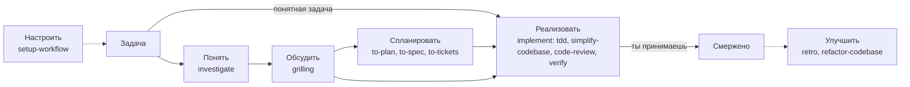

# agent-workflow

[English version](../README.md)

Рабочий процесс из небольших скиллов для агентов, которые пишут код. Каждый скилл делает один шаг: изучить задачу, обсудить, спланировать, реализовать, проверить, извлечь урок. Правила проекта ложатся поверх шагов: `setup-workflow` записывает их в `AGENTS.md` проекта, а каждый скилл читает их оттуда.

Набор адаптирует [скиллы Мэтта Покока](https://github.com/mattpocock/skills) и [pstack](https://github.com/cursor/plugins/tree/main/harness/pstack) Лорен Тан, и добавляет свои, например `to-plan`, `verify` и `writing-technical`. Автоматического конвейера нет. Шаги выбираешь ты, а права проекта решают, что агент может делать сам.

## Установка

Нужен Node.js 22.20 или новее. В папке проекта поставь `setup-workflow` из GitHub:

```bash
npx skills@latest add FOZERY/agent-workflow --skill setup-workflow --agent claude-code
```

Для Codex используй `--agent codex`. Для установки на всего пользователя добавь `--global`. Чтобы поставить другой скилл, замени `setup-workflow` на его имя. Другие клиенты и варианты установки описаны в [развёртывании скиллов](../skills/setup-workflow/references/skills.md).

## С чего начать

1. Запусти `/setup-workflow` (`$setup-workflow` в Codex). Он спросит про правила, проверки, права, источники фактов и агентов, предложит скиллы и запишет `AGENTS.md`.
2. Дай агенту задачу. Новую задачу, которую ты плохо знаешь, начни с `/investigate`. Понятную задачу просто попроси реализовать: `implement` запустится сам.

Не знаешь, какой скилл нужен? Запусти `/ask-workflow` со своим вопросом. Он посоветует скилл и ничего не запустит.

## Как устроен процесс



Каждый шаг необязателен. Небольшая понятная задача сразу идёт в `implement`.

В [гайде по скиллам](GUIDE.ru.md) каждый скилл описан с примером запроса. [Маршруты](FLOW.ru.md) подсказывают, с какого шага начать для твоей задачи.

## Скиллы по шагам

«Ты» значит, что скилл запускается только твоей командой. «Агент» значит, что агент может запустить его и сам, если задача подходит.

| Шаг | Скилл | Запускает | Что делает |
| --- | --- | --- | --- |
| Настроить | [`setup-workflow`](../skills/setup-workflow/SKILL.md) | Ты | Согласует правила, проверки, права и агентов проекта и записывает `AGENTS.md` |
| | [`setup-home-repo`](../skills/setup-home-repo/SKILL.md) | Ты | Делает общий дом для нескольких репозиториев, не перенося их код |
| | [`ask-workflow`](../skills/ask-workflow/SKILL.md) | Ты | Советует следующий скилл для твоей ситуации |
| Понять | [`investigate`](../skills/investigate/SKILL.md) | Ты | Изучает историю задачи и код, сохраняет файл фактов и объясняет задачу простыми словами |
| | [`recall`](../skills/recall/SKILL.md) | Ты | Восстанавливает, где остановилась недавняя работа по теме и что делать дальше |
| | [`research`](../skills/research/SKILL.md) | Агент | Отвечает на вопрос по первоисточникам и сохраняет отчёт со ссылками |
| Обсудить | [`grilling`](../skills/grilling/SKILL.md) | Агент | Задаёт вопросы, пока не приняты все решения по идее |
| | [`grill-with-docs`](../skills/grill-with-docs/SKILL.md) | Ты | То же самое, и попутно записывает термины и решения |
| | [`domain-modeling`](../skills/domain-modeling/SKILL.md) | Агент | Ведёт глоссарий и ADR |
| | [`prototype`](../skills/prototype/SKILL.md) | Агент | Делает временный код, чтобы ответить на вопрос о дизайне |
| Спланировать | [`to-plan`](../skills/to-plan/SKILL.md) | Ты | Сохраняет план реализации задачи |
| | [`to-spec`](../skills/to-spec/SKILL.md) | Ты | Превращает обсуждение в спецификацию в трекере |
| | [`to-tickets`](../skills/to-tickets/SKILL.md) | Ты | Разбивает работу на тикеты с зависимостями |
| | [`wayfinder`](../skills/wayfinder/SKILL.md) | Ты | Раскладывает большую неясную работу на тикеты-решения |
| Реализовать | [`implement`](../skills/implement/SKILL.md) | Агент | Ведёт задачу: мелкое пишет сам, крупное отдаёт исполнителям, проверяет результат |
| | [`tdd`](../skills/tdd/SKILL.md) | Агент | Пишет интеграционные и модульные тесты, которые доказывают реальное поведение, сначала тест |
| | [`simplify-codebase`](../skills/simplify-codebase/SKILL.md) | Агент | Находит, что упростить в изменённом коде |
| | [`verify`](../skills/verify/SKILL.md) | Агент | Проверяет, что изменение работает в запущенном продукте, так, как договорились в проекте |
| | [`code-review`](../skills/code-review/SKILL.md) | Агент | Проверяет изменения по стандартам проекта и по задаче |
| Улучшить | [`retro`](../skills/retro/SKILL.md) | Ты | Превращает ошибки недавних сессий в скиллы и правила |
| | [`refactor-codebase`](../skills/refactor-codebase/SKILL.md) | Ты | После этапа работы находит структурные проблемы в коде и переписывает одну |
| | [`refactor-docs`](../skills/refactor-docs/SKILL.md) | Ты | Делает документы понятнее, не меняя их смысла |
| | [`cleanup-artifacts`](../skills/cleanup-artifacts/SKILL.md) | Ты | Разбирает устаревшие заметки и планы и убирает одобренные так, чтобы их можно было вернуть |
| Писать | [`writing-for-people`](../skills/writing-for-people/SKILL.md) | Агент | Понятные ответы и объяснения для людей |
| | [`writing-technical`](../skills/writing-technical/SKILL.md) | Агент | Чёткие технические документы на контролируемом английском |
| | [`writing-for-agents`](../skills/writing-for-agents/SKILL.md) | Агент | Скиллы и `AGENTS.md`, которые агенты выполняют одинаково |
| | [`rephrase`](../skills/rephrase/SKILL.md) | Ты | Пересказывает последний ответ простыми словами |

## Внешние инструменты

Эти инструменты не входят в набор. Если ты выбираешь `verify` для проекта с интерфейсом, setup советует инструменты проверки интерфейса и ничего не ставит без твоего согласия.

- **Проверка интерфейса для `verify`:** [agent-browser](https://github.com/vercel-labs/agent-browser): агент открывает веб-страницы, прокликивает их и делает скриншоты. [agent-desktop](https://github.com/vercel-labs/agent-desktop) делает то же для нативных приложений.
- **Работа с агентами:** [Orca](https://orca.dev/) для worktree и сессий агентов. Его [плагин Excalidraw](https://orca.dev/plugins/stablyai/orca-plugins/orca-excalidraw) рисует и редактирует схемы.
- **Схемы в терминале:** [плагин termaid для Claude Code](https://termaid.com/claude-code.html) рисует схемы Mermaid из ответа прямо в терминале, пока ответ печатается. Поставь команду `termaid` через `brew install termaid`, потом выполни `/plugin install termaid --marketplace fasouto/termaid`.
- **Интерфейсы:** [Modern Web Guidance](https://github.com/GoogleChrome/modern-web-guidance) про API браузера, CSS, доступность и производительность. [learn-taste](https://github.com/emilkowalski/skills/blob/main/skills/learn-taste/SKILL.md) превращает повторяющиеся замечания по дизайну в предложения правил проекта.
- **Документация библиотек:** [find-docs](https://github.com/upstash/context7/blob/master/skills/find-docs/SKILL.md) для актуальных справок по API через Context7 CLI.

## Статус и лицензия

Скиллы проверены в изолированных проектах и в ежедневной работе. Полный прогон от настройки до смерженного PR целиком не проверялся. Ссылки и связи между скиллами проверяет `python3 scripts/check.py`. CI запускает его при каждом пуше.

Собственный код набора распространяется по [лицензии MIT](../LICENSE). Сторонние материалы сохраняют свои [уведомления и права](../THIRD_PARTY_NOTICES.md). Сохраняй нужные [уведомления](../THIRD_PARTY_NOTICES.md#distribution) вместе с установленными или выгруженными скиллами.
