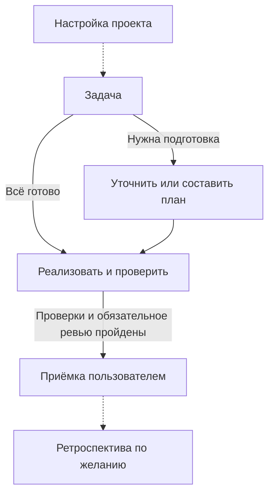

# agent-workflow

[English original](../README.md)

Собери харнесс для своего агента: инструкции проекта, скиллы и инструменты. Скилл задаёт порядок работы, например как составить план или проверить изменения.

Набор сочетает [скиллы Мэтта Покока](https://github.com/mattpocock/skills) с нашими скиллами для настройки проекта, планирования и письма.
Работа может начаться с идеи, готовой задачи или спецификации с зависимыми тикетами.
Для каждого случая можно выбрать только нужные шаги и сохранить свои требования, проверки и инструменты.
Набор не запускает конвейер и не управляет доступом.

## Основные скиллы

| Скилл | Когда использовать |
| --- | --- |
| [`setup-workflow`](../skills/setup-workflow/SKILL.md) | Нужно согласовать правила проекта, проверки, разрешения и список скиллов для установки. |
| [`investigate`](../skills/investigate/SKILL.md) | Пришла задача, и её нужно сначала изучить: откуда она, как устроен код, файл фактов и объяснение простым языком. |
| [`grilling`](../skills/grilling/SKILL.md) | Нужно найти риски и нерешённые вопросы в идее или плане. |
| [`wayfinder`](../skills/wayfinder/SKILL.md) | В большой работе есть открытые вопросы, которые стоит разобрать в отдельных тикетах. |
| [`to-plan`](../skills/to-plan/SKILL.md) | Задача понятна, но нужно сохранить план реализации без новой спецификации и тикетов. |
| [`to-spec`](../skills/to-spec/SKILL.md) | Согласованные требования нужно оформить в новую спецификацию. |
| [`to-tickets`](../skills/to-tickets/SKILL.md) | Работу нужно разбить на отдельные тикеты и указать зависимости между ними. |
| [`implement`](../skills/implement/SKILL.md) | Согласованную задачу нужно реализовать и проверить. Сессия становится оркестратором: мелкое пишет сама, крупное отдаёт исполнителям. |
| [`tdd`](../skills/tdd/SKILL.md) | Нужно сначала написать падающий тест, а затем внести минимальное изменение, чтобы он прошёл, или проверить, какие из существующих тестов нужны. |
| [`code-review`](../skills/code-review/SKILL.md) | Нужно сверить изменения со стандартами проекта и требованиями задачи. |
| [`simplify-codebase`](../skills/simplify-codebase/SKILL.md) | Нужно упростить изменённый код и убрать лишние проверки, запасные пути и абстракции. |

## Порядок работы

1. **Настрой проект.** Запусти `setup-workflow` при первой настройке или когда правила меняются. Отдельно одобри изменения в `AGENTS.md` и установку скиллов.
2. **Подготовь задачу, если нужно.** Разбери открытые вопросы или составь план. Если можно сразу приступать, пропусти этот шаг.
3. **Запусти реализацию и проверки.** Поручи работу агенту, который принимает твои исходные материалы. Перед приёмкой проверь результаты проверок и обязательного ревью.
4. **Улучши харнесс, если нужно.** Запусти `retro` после работы, чтобы превратить её ошибки в скиллы или правила.



[Рабочий процесс](FLOW.ru.md#выбор-маршрута) поможет выбрать маршрут и передать задачу исполнителю.

## Дополнительные скиллы

| Скилл | Когда использовать |
| --- | --- |
| [`ask-workflow`](../skills/ask-workflow/SKILL.md) | Нужен совет о следующем шаге, без запуска работы. |
| [`setup-home-repo`](../skills/setup-home-repo/SKILL.md) | Нужна общая точка входа для нескольких репозиториев без переноса кода и правил. |
| [`grill-with-docs`](../skills/grill-with-docs/SKILL.md) | Заодно с обсуждением дизайна нужно обновить глоссарий или записать решение. |
| [`domain-modeling`](../skills/domain-modeling/SKILL.md) | Нужно согласовать термины предметной области или записать архитектурное решение. |
| [`research`](../skills/research/SKILL.md) | Нужен отчёт со ссылками на первоисточники. |
| [`prototype`](../skills/prototype/SKILL.md) | Нужно сравнить варианты интерфейса или проверить модель состояния на временном прототипе. |
| [`draw-diagram`](../skills/draw-diagram/SKILL.md) | Схема поможет объяснить дизайн. После твоего согласия отдельный агент создаст редактируемую схему и PNG для просмотра. |
| [`retro`](../skills/retro/SKILL.md) | Нужно превратить ошибки недавних сессий в новый скилл, правило в скилле, правило проекта или урок. |
| [`refactor-codebase`](../skills/refactor-codebase/SKILL.md) | Этап работы закончен, и нужно найти структурные проблемы в коде и переписать одну из них с сохранением поведения. |
| [`refactor-docs`](../skills/refactor-docs/SKILL.md) | Нужно улучшить текст или структуру документа без изменения смысла. |
| [`cleanup-artifacts`](../skills/cleanup-artifacts/SKILL.md) | Нужно разобрать устаревшие материалы и согласовать, какие из них убрать так, чтобы можно было восстановить. |
| [`writing-for-people`](../skills/writing-for-people/SKILL.md) | Нужны понятные ответы и объяснения для людей. |
| [`writing-technical`](../skills/writing-technical/SKILL.md) | Нужно написать техническую документацию, спецификацию, тикет или запись в память проекта. |
| [`writing-for-agents`](../skills/writing-for-agents/SKILL.md) | Нужно написать переиспользуемые инструкции, например скилл или `AGENTS.md`. |
| [`rephrase`](../skills/rephrase/SKILL.md) | Последний ответ получился слишком заумным, и его нужно пересказать простыми словами. |

### Внешние инструменты

`setup-workflow` не устанавливает и не включает эти инструменты автоматически.

- **Работа с агентами:** [Orca](https://orca.dev/) для отдельных worktree и сессий. Его [плагин Excalidraw](https://orca.dev/plugins/stablyai/orca-plugins/orca-excalidraw) редактирует схемы без скилла.
- **Работа над интерфейсом:** [Modern Web Guidance](https://github.com/GoogleChrome/modern-web-guidance) для CSS, браузерных API, доступности и производительности. [learn-taste](https://github.com/emilkowalski/skills/blob/main/skills/learn-taste/SKILL.md) предлагает правила проекта на основе повторяющихся замечаний по дизайну.
- **Проверки интерфейса:** [agent-browser](https://github.com/vercel-labs/agent-browser) для интерактивных веб-страниц. [agent-desktop](https://github.com/vercel-labs/agent-desktop) для нативных приложений.
- **Документация библиотек:** [find-docs](https://github.com/upstash/context7/blob/master/skills/find-docs/SKILL.md) ищет актуальную справку по API через Context7 CLI.

## Установка

Нужен Node.js 22.20 или новее. Из каталога своего проекта установи `setup-workflow` с GitHub:

```bash
npx skills@1.9.0 add FOZERY/agent-workflow --skill setup-workflow --agent codex
```

В Codex запусти `$setup-workflow`. Для Claude Code установи с `--agent claude-code`, затем запусти `/setup-workflow`.
Чтобы установить другой скилл, замени `setup-workflow` в команде установки на его имя.
Setup пишет `AGENTS.md` по правилам `writing-technical` и `writing-for-agents`. Если их нет, setup предложит их установить.
Добавляй `--global` только для установки на уровне пользователя.

Для других клиентов и способов установки смотри [руководство по размещению скиллов](../skills/setup-workflow/references/skills.md).

## Статус и лицензия

Метаданные и обнаружение скиллов проверены в изолированных проектах. Полный сценарий от настройки до PR не проверяли.
При установке или экспорте скиллов сохраняй применимые [уведомления](../THIRD_PARTY_NOTICES.md#distribution) и лицензии.

Собственные материалы распространяются по [MIT](../LICENSE). Сторонние материалы сохраняют свои [условия и права](../THIRD_PARTY_NOTICES.md). Право на распространение части пакета Excalidraw не подтверждено.
